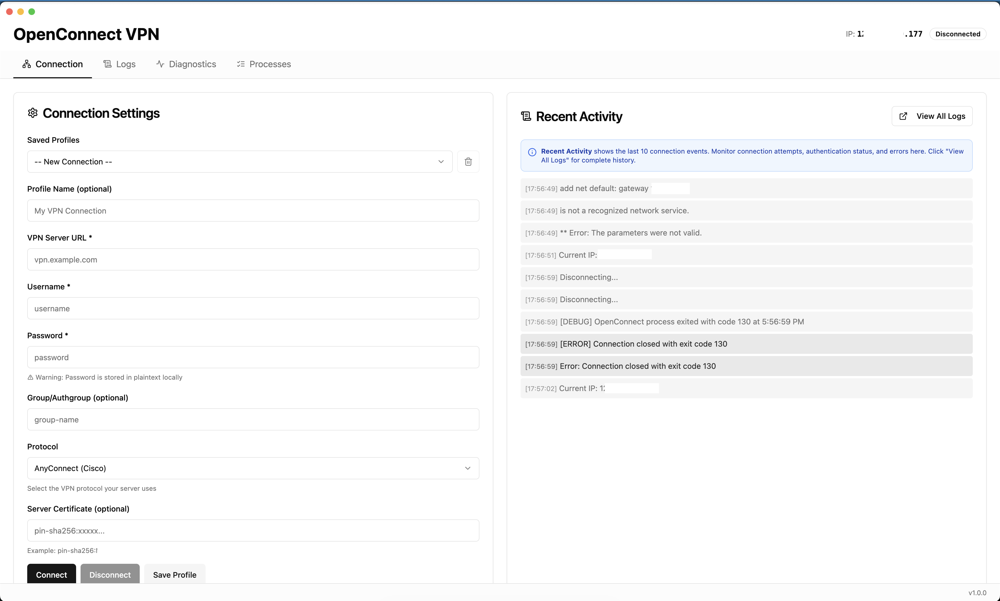
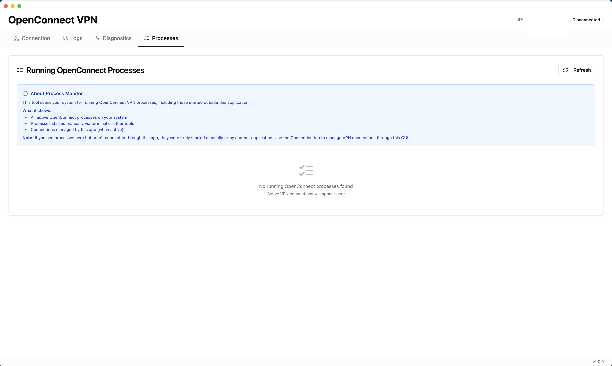

# OpenConnect VPN GUI（macOS 中文客户端）

基于 [jadedm/openconnect-gui](https://github.com/jadedm/openconnect-gui) 二次开发的 macOS OpenConnect 图形客户端，使用 **Electron**、**React** 与 **shadcn/ui** 构建。当前版本 **v1.3.0**，界面、日志与系统提示已全部汉化，定位为个人轻量客户端。

> 本项目为个人维护的 fork，仅提供 Apple Silicon（arm64）构建。

## 界面截图

> 截图为上游版本界面，当前版本已完成中文化。

### 连接页



左侧为连接设置，右侧为最近活动。

### 进程监控



查看并管理系统中运行的 OpenConnect 进程（需要 sudo 认证）。

## 功能

### 连接与配置

- 完整的 OpenConnect 支持，兼容 AnyConnect、GlobalProtect、Fortinet 等协议
- 保存、加载、删除多个 VPN 配置，支持认证组、服务器证书指纹（`pin-sha256:...`）
- 密码使用 macOS 钥匙串（`safeStorage`）加密保存，旧版明文配置首次加载时自动迁移
- 托盘快速连接：无需打开主窗口即可使用已保存配置发起连接、断开连接
- 开机自动启动（仅打包版，可在托盘菜单中开关），登录后后台驻留菜单栏
- 连接状态显示、系统通知与错误提示（主窗口隐藏时同样能收到反馈）
- 退出确认：VPN 连接中退出会先确认

### 网络诊断

- 连接前自动清理残留主机路由，修复更换网络后报 `Can't assign requested address` 的问题
- 服务器连通性测试（`nc`）
- 路由表与网络接口查看
- 手动删除阻塞连接的问题路由

### 自动更新

- 应用启动后静默检查 GitHub Releases，有新版本时发送系统通知
- 托盘菜单「检查更新」可手动检查并查看更新说明
- 确认后自动下载 dmg 到「下载」目录并打开，拖入「应用程序」覆盖即可升级

### 其他

- 连接日志按级别着色，支持错误 / 警告 / 流程筛选、复制与清空
- 连接前自动探测服务器 TCP 连通性，失败时给出具体原因与路由信息
- 主界面「关于」：查看当前版本、检查更新、阅读更新说明并下载安装包
- 进程监控：查看并结束系统内所有 OpenConnect 进程
- 深色模式、上下文帮助、页脚版本号
- 启动时自动检查 OpenConnect、expect 与 sudo 权限

## 安装

### 下载

从 [Releases](https://github.com/hkproto1/openconnect-gui/releases/latest) 下载最新 `.dmg`（当前为 `OpenConnect VPN-1.3.0-arm64.dmg`）。

### 安装步骤

1. 打开 dmg，将「OpenConnect VPN」拖入「应用程序」
2. 本应用未签名，首次启动需清除隔离标记：

```bash
xattr -cr "/Applications/OpenConnect VPN.app"
open "/Applications/OpenConnect VPN.app"
```

也可以右键点击应用选择「打开」，在安全提示中再次确认。

### 依赖

应用会在启动时检查以下依赖：

- **OpenConnect**：`brew install openconnect`
- **expect**：macOS 一般自带（`/usr/bin/expect`）
- **sudo 权限**：当前用户需在管理员组

### 系统要求

- macOS 10.13 或更高
- Apple Silicon（M1/M2/M3 等），暂未提供 Intel 构建

## 升级

- **1.2.0 及以上**：启动后自动检查新版本，或从托盘菜单 / 主界面「关于」选择「检查更新」，确认后自动下载 dmg 并打开，拖入「应用程序」覆盖即可
- **1.1.1 及更早**：旧版本不含更新功能，需要手动下载一次最新版本
- 由于应用未签名，更新采用「下载 + 手动覆盖」方式，不会静默替换安装
- 首次启动会把旧版 `profiles.json` 迁移为钥匙串加密格式；迁移后旧版本将无法读取该配置

升级前请先退出正在运行的旧版本（连接中退出会断开 VPN）。

## 使用说明

### 连接到 VPN

1. 在「连接」页填写服务器地址（如 `https://vpn.example.com:443`）、用户名、密码
2. 按需选择协议、认证组，或填写服务器证书指纹
3. 点击「连接」，按提示输入 macOS 管理员密码（OpenConnect 需要 sudo 权限）
4. 状态依次变为：未连接 → 连接中 → 已连接；页头公网 IP 会自动刷新

连接前应用会自动检查并清理指向旧网段网关的残留主机路由，无需手动处理。

### 保存配置

填写连接信息与配置名称后点击「保存配置」。密码在保存时通过 macOS 钥匙串加密，配置文件权限为 `0600`。

### 托盘菜单

- **状态**：显示当前连接状态
- **快速连接**：选择已保存配置直接连接
- **断开连接**：断开当前 VPN
- **开机自动启动**：登录后自动驻留菜单栏
- **检查更新**：手动检查新版本
- **退出**：连接中退出会先确认

### 网络诊断

「诊断」页可用于排查连接问题：

1. 测试 VPN 服务器连通性
2. 查看路由表与网络接口
3. 问题路由以红色高亮，可输入 sudo 密码后删除
4. 删除后自动刷新

### 进程监控

「进程」页列出本应用、终端或其他工具启动的 OpenConnect 进程，可刷新列表或输入 sudo 密码强制结束进程。强制结束会断开对应 VPN。

## 开发

### 环境准备

- Node.js 22（见 `.nvmrc`，`nvm use` 即可）与 npm
- OpenConnect：`brew install openconnect`
- expect：`which expect` 应返回 `/usr/bin/expect`

```bash
git clone https://github.com/hkproto1/openconnect-gui.git
cd openconnect-gui
npm install
```

### 常用命令

```bash
npm start        # 开发模式：Vite 开发服务器 + Electron（热更新）
npm test         # 运行 node:test 单元测试
npm run build    # 构建渲染层到 dist/
npm run package  # 构建并打包 dmg 到 release/（不自动发布）
```

开发模式会先启动 `http://localhost:5173`，再启动 Electron 加载对应页面。

### 打包说明

- 输出目录为 `release/`，dmg 命名如 `OpenConnect VPN-1.3.0-arm64.dmg`
- 打包脚本固定使用 `--publish never`，发布由 `gh release create` 手动执行
- 打包白名单必须包含 `src/main/**/*`，否则安装版启动会报 `Cannot find module`

### 项目结构

```
openconnect-gui/
├── main.js                      # Electron 主进程：窗口、托盘、连接、更新、IPC
├── preload.js                   # 渲染层安全 IPC 桥
├── vpn-connect.exp              # 交互式认证脚本（读取 0600 凭据文件）
├── pages/                       # 各页面 HTML 入口
├── src/
│   ├── App.jsx                  # 主界面与标签导航
│   ├── Splash.jsx               # 启动检查页
│   ├── Installer.jsx            # OpenConnect 安装引导
│   ├── PasswordPrompt.jsx       # sudo 密码输入页
│   ├── components/              # 连接、日志、诊断、进程等组件
│   ├── main/
│   │   ├── profiles.js          # 配置加密读写与 v1→v2 迁移
│   │   ├── parsers.js           # 路由表/网卡输出解析
│   │   ├── routes.js            # 残留主机路由检测与清理
│   │   └── updater.js           # GitHub Releases 检查与 dmg 下载
│   └── ...
├── test/                        # node:test 单元测试
├── assets/                      # 应用与托盘图标
├── scripts/                     # OpenConnect 安装脚本
└── release/                     # 打包输出（不入库）
```

### 架构简述

1. **主进程**（`main.js`）：管理窗口与托盘、执行启动检查、准备凭据文件、通过 expect 启动 `sudo openconnect`、处理 IPC、检查更新
2. **expect 脚本**（`vpn-connect.exp`）：为 OpenConnect 创建 PTY，自动应答 sudo、用户名、密码提示；凭据来自临时文件，读取后立即删除
3. **预加载脚本**（`preload.js`）：通过上下文隔离暴露白名单 API
4. **React 渲染层**（`src/`）：连接表单、日志、诊断、进程监控等界面

### 认证流程

1. 用户填写连接信息并点击连接
2. 应用弹出 sudo 密码窗口
3. sudo 密码、VPN 用户名、VPN 密码写入权限为 `0600` 的临时文件
4. expect 脚本读取凭据后立即删除文件，并启动 `sudo openconnect`
5. 脚本识别 sudo、用户名、密码提示并自动应答
6. 连接建立后刷新公网 IP，失败则给出具体错误提示

### 测试

```bash
npm test
```

覆盖路由表/网卡解析、残留路由判定、版本比较与更新检查逻辑。GitHub Actions 会在 macOS 上执行测试与前端构建。

## 安全说明

- 渲染层启用上下文隔离，仅通过 `preload.js` 暴露白名单 IPC
- 所有系统命令使用 `spawn()` 与参数数组，避免命令注入；PID、路由目标、端口等均做格式校验
- 配置密码通过 macOS 钥匙串加密（`safeStorage`），文件权限 `0600`，写入采用临时文件 + 原子替换
- sudo 密码与 VPN 密码不再出现在进程命令行（`ps aux` 不可见），改为临时凭据文件
- 已知限制：应用未签名/未公证，请仅从本仓库 Releases 下载

## 常见问题

### 更换网络后连接失败，日志出现 `Can't assign requested address`

v1.2.0 起会在连接前自动清理指向旧网段网关的残留主机路由。若仍失败，v1.3.0 起的日志会输出服务器当前路由、默认网关与残留路由详情（含删除命令），可直接按「建议」行处理：

1. 打开「诊断」页，查看服务器 IP 是否存在异常主机路由
2. 删除红色高亮的问题路由后重试
3. 也可在终端执行 `sudo route delete <服务器IP>` 后重新连接

### sudo 密码错误或 VPN 认证失败

- sudo 密码为 macOS 登录密码，需当前用户在管理员组
- VPN 认证失败请检查用户名、密码、认证组与服务器地址
- 使用证书指纹时确认 `pin-sha256:` 值正确

### 连接成功但无法上网

- 查看日志中的 vpnc-script 报错信息
- 隧道可能已建立但路由配置失败，可在「诊断」页检查路由
- 必要时执行 `sudo route add -net 0.0.0.0/0 <网关>`

### 启动提示「已损坏」或无法打开

应用未签名，首次启动需清除隔离标记：

```bash
xattr -cr "/Applications/OpenConnect VPN.app"
```

### 存在残留 OpenConnect 进程

在「进程」页结束对应进程，或使用终端：

```bash
ps aux | grep openconnect | grep -v grep
sudo kill -9 <PID>
```

### 检查更新失败

- 确认网络可访问 `api.github.com`
- GitHub API 未认证请求存在频率限制，稍后重试
- 也可直接打开 [Releases](https://github.com/hkproto1/openconnect-gui/releases) 手动下载

## 数据存储

配置保存在：

```
~/Library/Application Support/openconnect-gui/profiles.json
```

v2 格式仅保存非敏感字段与钥匙串加密后的密码。钥匙串密钥与当前用户/系统绑定，换机或重装系统后需要重新输入密码。

## 已知限制

- 仅提供 arm64 构建
- 未签名/未公证，首次启动需手动清除 quarantine
- 自动更新为「下载 + 手动覆盖安装」，无法静默替换
- 暂不支持证书客户端认证、MFA 的图形化配置（可在终端使用 openconnect 完成）
- 暂未提供 Intel 构建

## 后续计划

- 自动重连与网络变化检测
- 证书认证、MFA 支持
- Intel（x64）构建
- 配置导入/导出（加密）

## 许可证

MIT，详见 [LICENSE](LICENSE)。

上游项目：[jadedm/openconnect-gui](https://github.com/jadedm/openconnect-gui)，作者 [Manish Jadhav](https://manishj.com)。

## 反馈

欢迎提交 Issue 或 Pull Request：https://github.com/hkproto1/openconnect-gui/issues
